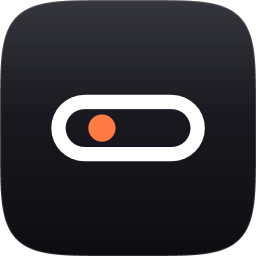
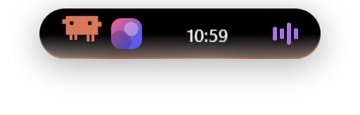
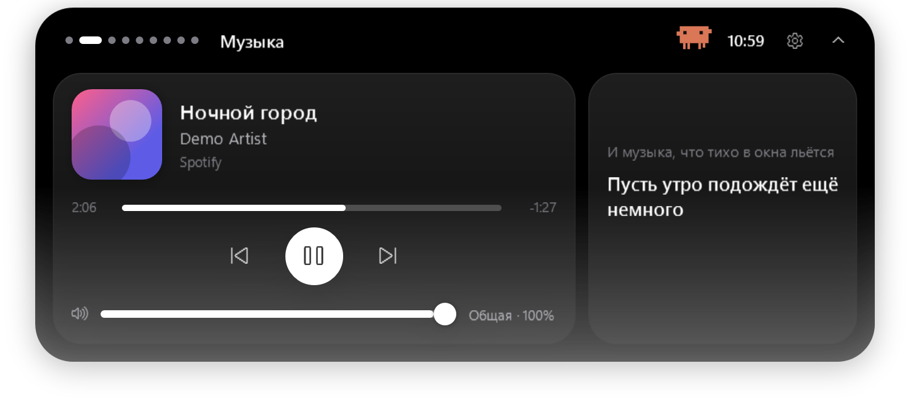
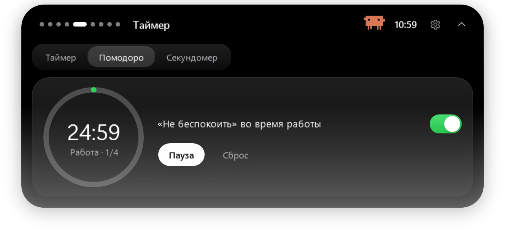
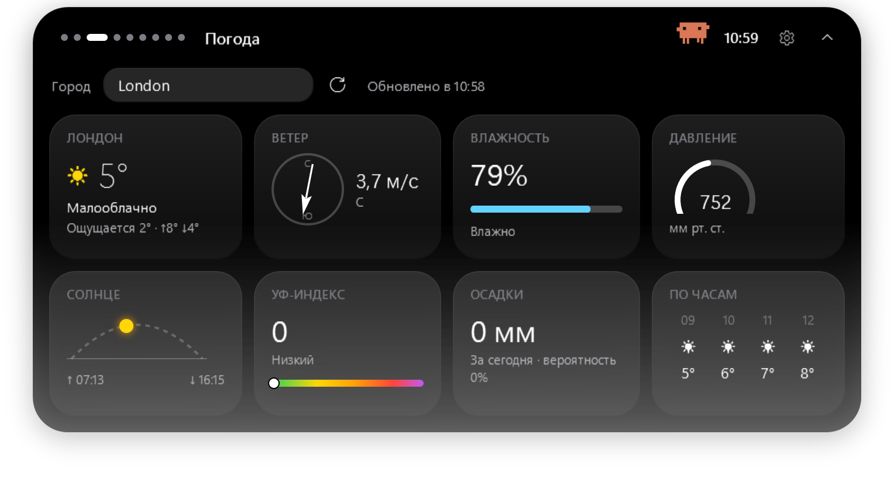
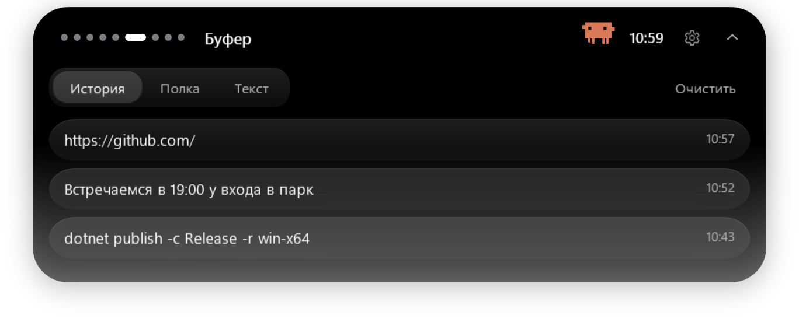
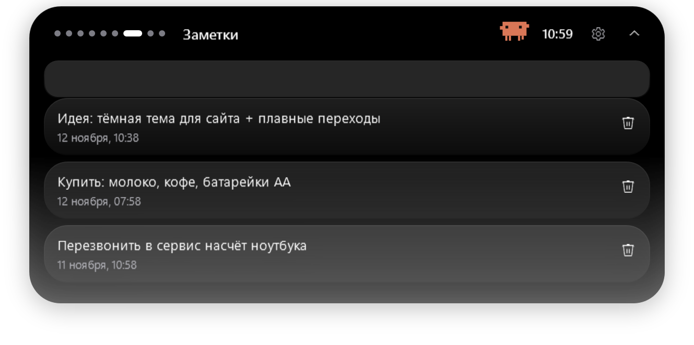
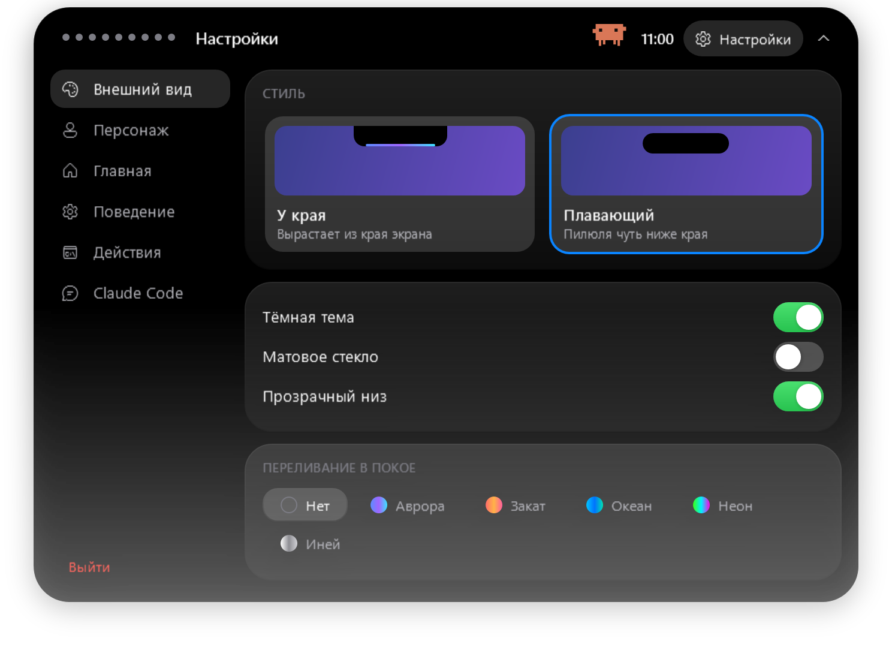

<div align="center">



<br/>

# Dynamic Island for Windows 10 & 11

### An authentic, ultra-smooth iOS 18 / iPhone 16 Pro Dynamic Island for your PC

**Music with synchronized live lyrics, timers and stopwatch, weather, notes, clipboard history, calendar, system stats, and 22 interactive characters living in the pill — fast, organic, and ultra-resource-efficient.**

**English** · [Русский](README.ru.md)

<br/>

[](https://github.com/abramovichegor33-web/dynamic-island-windows/releases/download/v2.0.0/DynamicIsland.exe)
[](https://github.com/abramovichegor33-web/dynamic-island-windows/releases/latest)
[](https://dotnet.microsoft.com/)
[](LICENSE)

<br/>



</div>

---

## ⚡ Performance & Deep Optimization

This edition has been deeply profiled and optimized for zero idle overhead, butter-smooth 60+ FPS physics, and zero gaming impact:

| Component | Standard / Original | Optimized Edition | Benefit |
| :--- | :--- | :--- | :--- |
| **Glass Background Capture** | Screengrabs every 700 ms via GDI/Magnification API | **iOS Pure OLED Black (`#000000`)** with hairline rim | **0% GPU & compositor overhead** in background |
| **Game FPS Meter** | ETW kernel session (`TraceEventSession`) on all DXGI/D3D9 calls | Clean, lightweight telemetry provider | **Zero game stuttering** and no kernel interrupts |
| **Monitor Brightness** | Polled 4x/sec over hardware I2C/DDC-CI bus (`DeviceIoControl`) | Eliminated periodic driver polling | **No display bus lag** or micro-freezes |
| **Embedded Browser** | Heavy Chromium background instance (WebView2) | Stripped out completely | **Saves 300–400 MB RAM** and multiple background processes |
| **USB Headset Scans** | Continuous USB HID++ enumeration & local WebSockets | Disabled background probing | No unnecessary USB wakeups |
| **Liquid Physics Mesh** | Heap allocations (`.Skip(1).ToList()`) every frame | Direct index loops with reusable buffers | **0 GC allocations per frame** for fluid organic motion |
| **Cursor Gaze Tracking** | Fixed 33 ms polling timer | Adaptive (throttles to 120 ms when cursor is away) | **80% fewer idle CPU interrupts** |

---

## 📱 Features

<div align="center">

| 🎵 Music & Live Lyrics | ⏱️ Timers & Pomodoro | 🌤️ Weather |
| :---: | :---: | :---: |
|  |  |  |
| High-res album art, volume scrubber, and synced lyrics | Presets, stopwatch, and Pomodoro mode with focus tracking | Live weather conditions, forecasts, and city search |

| 📋 Clipboard History | 📝 Quick Notes | ⚙️ Settings & Themes |
| :---: | :---: | :---: |
|  |  |  |
| Text history, pinning, and instant paste | Fast checklist and sticky notes always accessible | 22 live interactive characters, color palette, and spring controls |

</div>

- 👾 **22 Interactive Characters**: eyes, cats, dinosaurs, robots, and pets that track the cursor and react to your music.
- 🎚️ **Per-App Audio Mixer**: adjust the volume of any running application directly from the island.
- 📐 **Full Layout Customization**: drag island borders to adjust width, rearrange tabs, hide modules you don't use.
- 🪟 **Docked or Floating**: magnetic attachment to the top screen edge or floating gently below.

---

## 🚀 Download & Installation

Zero installer needed. Runs portable with no administrator privileges required.

1. Go to the **[Latest Release](https://github.com/abramovichegor33-web/dynamic-island-windows/releases/latest)**.
2. Download **`DynamicIsland.exe`**.
3. Run the executable. The island will smoothly expand at the top of your display!

---

## ⌨️ Shortcuts

| Shortcut | Action |
| :--- | :--- |
| <kbd>Win</kbd> + <kbd>Shift</kbd> + <kbd>I</kbd> | Toggle Expand / Fold Island |
| <kbd>Win</kbd> + <kbd>Shift</kbd> + <kbd>C</kbd> | Quick Command Palette |
| <kbd>Win</kbd> + <kbd>Shift</kbd> + <kbd>S</kbd> | Smart Screenshot with OCR |
| Mouse Wheel over Pill | Switch active widget (music, timer, downloads) |
| Click outside | Fold open island away |

---

## 🛠️ Build from Source

Requirements: **.NET 8 SDK** (Windows 10 / 11 x64).

```bash
# Clone the repository
git clone https://github.com/abramovichegor33-web/dynamic-island-windows.git
cd dynamic-island-windows

# Build Release
dotnet build DynamicIsland/DynamicIsland.csproj -c Release

# Or publish self-contained single-file .exe
dotnet publish DynamicIsland/DynamicIsland.csproj -c Release -r win-x64 --self-contained true -p:PublishSingleFile=true
```

---

## 📄 License

Distributed under the [MIT License](LICENSE).
Built upon the foundations of [Atoll by Fuwni](https://github.com/Fuwni/dynamic-island-windows).
