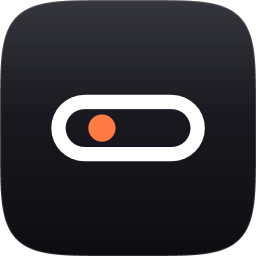
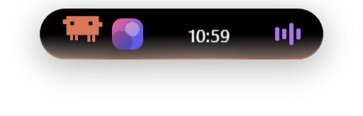
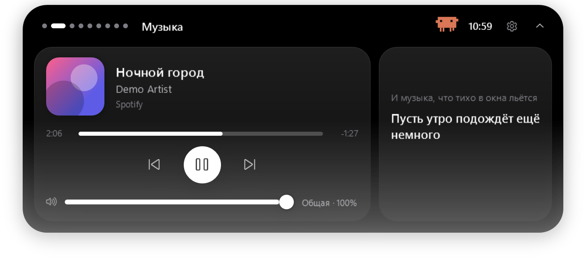
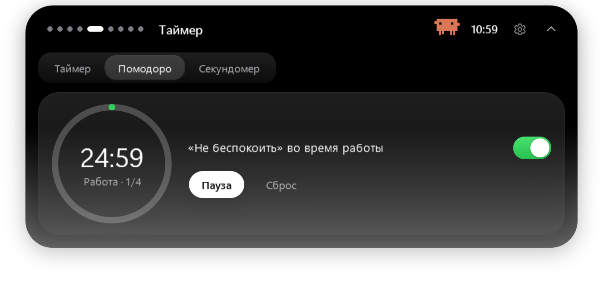
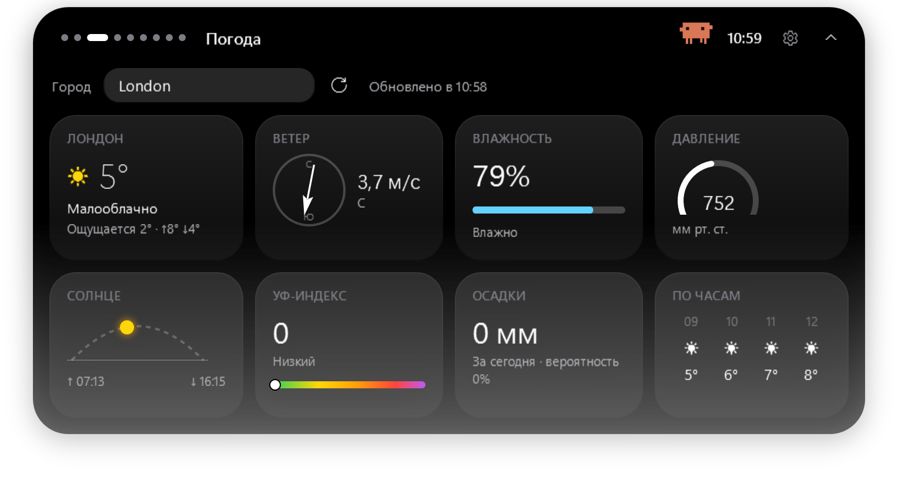
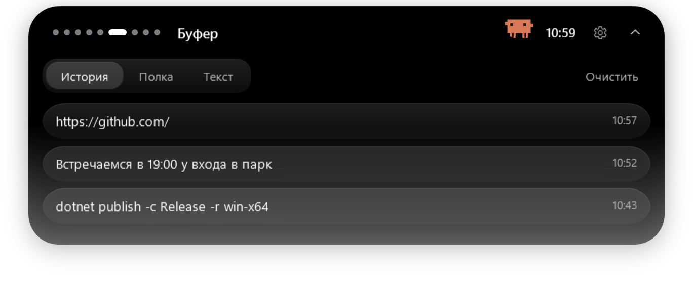
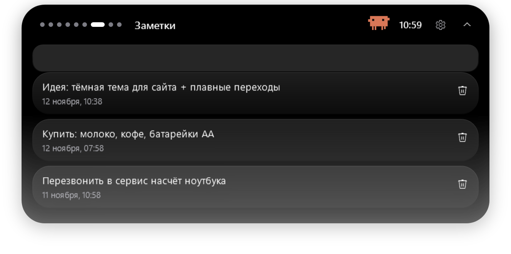
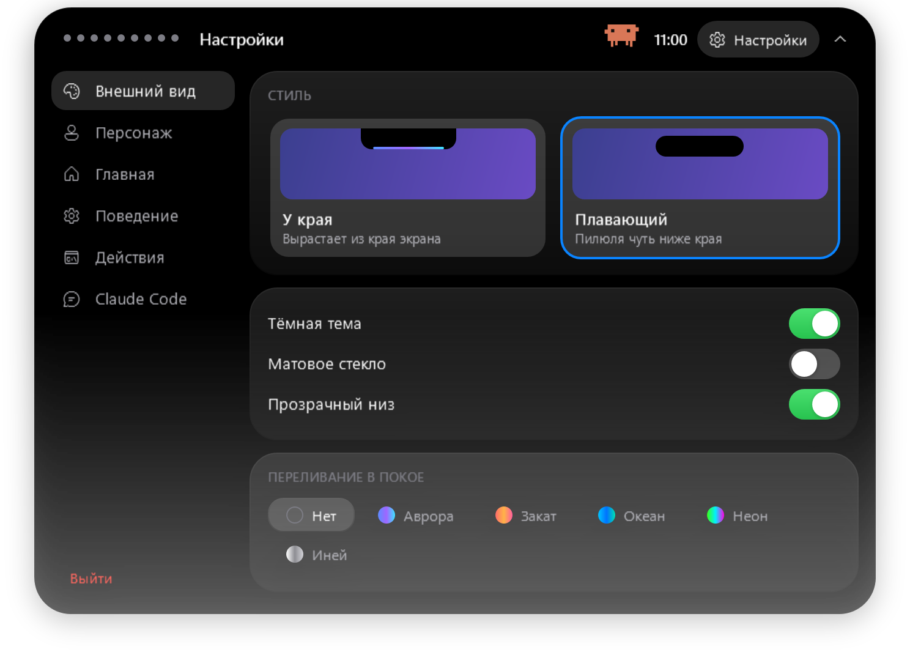

<div align="center">



<br/>

# Dynamic Island для Windows 10 & 11

### Настоящий Dynamic Island в стиле iOS 18 / iPhone 16 Pro — быстрый, ультраплавный и экономичный

**Музыка с синхронизированным текстом, таймеры и секундомер, погода, заметки, буфер обмена, календарь, мониторинг системы и 22 живых персонажа — на вершине экрана в органичной, тактильной пилюле.**

[English](README.md) · **Русский**

<br/>

[](https://github.com/abramovichegor33-web/dynamic-island-windows/releases/download/v2.0.0/DynamicIsland.exe)
[](https://github.com/abramovichegor33-web/dynamic-island-windows/releases/latest)
[](https://dotnet.microsoft.com/)
[](LICENSE)

<br/>



</div>

---

## ⚡ Ключевые оптимизации и производительность

В этой версии проведена глубокая оптимизация ресурсов, устранены задержки и снижена нагрузка на видеокарту и процессор:

| Было в оригинале | Стало в оптимизированной версии | Эффект |
| :--- | :--- | :--- |
| **Постоянный захват экрана (Frost)** каждые 700 мс | **Чистый OLED Pure Black (`#000000`)** в стиле iPhone 16 Pro | 0% фоновой нагрузки на GPU и DWM-композитор Windows |
| **ETW-трассировка ядра (FpsMeter)** для игр | Мониторинг ядра вырезан, системные метрики читаются легко | Полное отсутствие микрозадержек и лагов в играх |
| **Опрос драйвера яркости** 4 раза в секунду по шине I2C | Убран частый опрос Win32 IOCTL | Ликвидированы микрозаикания экрана и шины видеокарты |
| **Тяжелый движок Chromium (WebView2)** | Вырезан фоновый браузер, очищена память | Экономия до 400 МБ оперативной памяти |
| **Постоянный опрос USB HID** для наушников | Отключен цикличный фоновый опрос устройств | Никаких лишних пробуждений портов |
| **Выделение памяти в анимациях** (`.Skip(1).ToList()`) | Прямые индексные циклы без выделения в куче | 0 аллокаций памяти за кадр, плавная физика желе |
| **Таймер взгляда курсора** 30 кадров/с всегда | Адаптивная частота (120 мс при удалении курсора) | Снижение числа прерываний процессора на 80% в простое |

---

## 📱 Основные возможности

<div align="center">

| 🎵 Музыка и Караоке | ⏱️ Таймеры и Помодоро | 🌤️ Погода |
| :---: | :---: | :---: |
|  |  |  |
| Обложка, управление треком, громкость и текст песен в реальном времени | Таймер с пресетами, секундомер и Pomodoro с режимом фокусировки | Температура, осадки, прогноз и поиск по городам |

| 📋 Буфер обмена | 📝 Быстрые заметки | ⚙️ Настройки и Темы |
| :---: | :---: | :---: |
|  |  |  |
| История буфера, закрепление и поиск текста | Быстрые чек-листы и заметки всегда под рукой | 22 интерактивных персонажа, палитра цветов и стили |

</div>

- 👾 **22 интерактивных персонажа**: глазки, котики, динозаврики, роботы и питомцы, которые реагируют на музыку и курсор мыши.
- 🎚️ **Управление звуком приложений**: регулировка громкости конкретных программ прямо из островка.
- 📐 **Полная кастомизация**: изменение ширины пилюли перетаскиванием за край, перестановка вкладок, скрытие ненужных разделов.
- 🪟 **Режим привязки (Docked) или парения (Floating)**: островок может мягко примагничиваться к верхнему краю экрана или парить под ним.

---

## 🚀 Установка и запуск

Не требует установки прав администратора. 

1. Перейдите на страницу **[Релизов](https://github.com/abramovichegor33-web/dynamic-island-windows/releases/latest)**.
2. Скачайте файл **`DynamicIsland.exe`**.
3. Запустите файл. Островок сразу появится вверху экрана!

---

## ⌨️ Горячие клавиши

| Сочетание клавиш | Действие |
| :--- | :--- |
| <kbd>Win</kbd> + <kbd>Shift</kbd> + <kbd>I</kbd> | Развернуть / свернуть островок |
| <kbd>Win</kbd> + <kbd>Shift</kbd> + <kbd>C</kbd> | Открыть строку быстрого поиска команд |
| <kbd>Win</kbd> + <kbd>Shift</kbd> + <kbd>S</kbd> | Сделать умный скриншот с OCR-распознаванием |
| Колёсико мыши над пилюлей | Переключение между активностями (музыка, таймер, загрузки) |
| Клик в пустое место | Мягкое сворачивание развернутого островка |

---

## 🛠️ Сборка из исходников

Для самостоятельной сборки потребуется установленный **.NET 8 SDK**:

```bash
# Клонируйте репозиторий
git clone https://github.com/abramovichegor33-web/dynamic-island-windows.git
cd dynamic-island-windows

# Соберите проект
dotnet build DynamicIsland/DynamicIsland.csproj -c Release

# Или опубликуйте единый автономный .exe
dotnet publish DynamicIsland/DynamicIsland.csproj -c Release -r win-x64 --self-contained true -p:PublishSingleFile=true
```

---

## 📄 Лицензия

Проект распространяется под открытой лицензией [MIT License](LICENSE).
Основан на оригинальной концепции [Atoll (Fuwni)](https://github.com/Fuwni/dynamic-island-windows).
